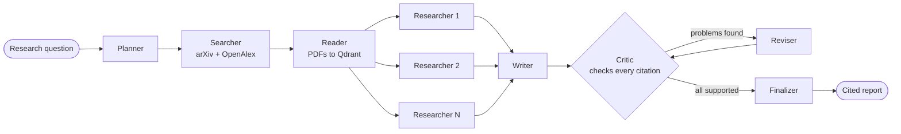

# ScholarScout 🔭

**A multi-agent research assistant that reads the papers and fact-checks its own citations.**

[](https://github.com/amnanazir101-maker/scholarscout/actions/workflows/ci.yml)


Ask a research question. ScholarScout breaks it into sub-questions, searches **arXiv** and
**OpenAlex**, reads the top papers in full, and sends parallel researcher agents to write cited
notes. A writer agent merges the notes into a literature review. Then a **critic agent checks
every cited sentence against the paper it cites** and sends problems back for revision. The
reference list is built from paper metadata, so it cannot contain made-up papers.

It runs for free on Gemini's free tier. Switching to Claude takes one setting.

**Example output:** [State space models vs. transformers](examples/state-space-models-vs-transformers.md),
a real run that screened 81 papers, read 15 (4 in full), cited 11, and had all 26 cited
statements confirmed by the critic agent after one revision round.

<!-- Add a demo GIF here once you have recorded one:  -->

## What makes it different

| | |
|---|---|
| **Parallel agents** | One researcher agent per sub-question, fanned out with LangGraph's `Send` API (map-reduce). |
| **Corrective retrieval** | A researcher that finds weak evidence writes its own follow-up query and searches again. |
| **Self-checking** | A critic agent verifies each cited statement against the abstract and the best-matching full-text passages. A reviser agent fixes what fails. |
| **No hallucinated references** | The model only writes IDs such as `[P3]`. Code validates them, removes unknown ones and builds the numbered references from metadata. |
| **Measured** | An evaluation harness compares it against a single-agent RAG baseline with the same sources and evidence budget. |
| **Free to run** | Defaults to Gemini's free tier (`gemini-3.8-flash`) and switches to another free model when one is busy. Gemini and Claude sit behind one small interface, so either provider runs the same agents. |
| **Runs on a laptop** | Local CPU embeddings (FastEmbed, ONNX) and an in-memory Qdrant index. arXiv and OpenAlex need no key. |
| **Three interfaces** | CLI, Streamlit web app, and an MCP server for Claude Code and Claude Desktop. |

## How it works



| Agent | What it does |
|---|---|
| Planner | Splits the question into 3-4 sub-questions, each with a search query (structured output). |
| Searcher | Queries arXiv and OpenAlex in parallel, merges duplicates across sources, and ranks papers by `0.75 × relevance + 0.15 × citations + 0.10 × recency`. |
| Reader | Downloads the top arXiv PDFs, removes the bibliography, splits the text into passages and indexes everything in Qdrant. |
| Researchers | Run in parallel. Each retrieves passages for its sub-question (at most two per paper), writes a cited note, and searches again if the evidence is thin. |
| Writer | Merges the notes into a review with a TL;DR, themed findings, a comparison table and open problems. |
| Critic | Extracts every cited statement (prose sentences and table rows) and judges it against the cited papers, in parallel batches. |
| Reviser | Rewrites or removes unsupported statements, then the critic checks again (1 round by default). |
| Finalizer | Removes invalid citation IDs, numbers the citations, lists any claims that still could not be confirmed, and adds the references. |

## Quickstart

You need Python 3.10+ and a free Gemini API key from
[Google AI Studio](https://aistudio.google.com/apikey).

```bash
git clone https://github.com/amnanazir101-maker/scholarscout.git
cd scholarscout
python -m venv .venv
.venv\Scripts\activate            # macOS/Linux: source .venv/bin/activate
pip install -e ".[app,mcp,dev]"
cp .env.example .env              # then paste your GEMINI_API_KEY into .env
```

To use Claude instead, set `SCHOLARSCOUT_PROVIDER=claude` and `ANTHROPIC_API_KEY` in `.env`.

**Command line**

```bash
scholarscout "How do state space models compare with transformers?" -o review.md --json review.json
```

The CLI shows each agent's progress, prints the report, and ends with the papers cited, the
share of verified statements and the time taken (plus the cost when you use a paid API).

**Web app**

```bash
streamlit run app.py
```

Shows live agent progress, the report, a sources table, the claim-by-claim fact-check and each
researcher's notes. Pick the provider and paste a key in the sidebar.

**MCP server** (use ScholarScout as a tool inside Claude Code or Claude Desktop)

```bash
# use the full path so the command works even when the venv is not activated
claude mcp add scholarscout -- C:/path/to/scholarscout/.venv/Scripts/scholarscout-mcp.exe
# macOS/Linux: claude mcp add scholarscout -- /path/to/scholarscout/.venv/bin/scholarscout-mcp
```

For Claude Desktop, add this to `claude_desktop_config.json`:

```json
{
  "mcpServers": {
    "scholarscout": {
      "command": "C:/path/to/scholarscout/.venv/Scripts/scholarscout-mcp.exe",
      "env": { "GEMINI_API_KEY": "your-free-key" }
    }
  }
}
```

It exposes two tools: `search_papers` and `literature_review`.

**Python**

```python
from dotenv import load_dotenv
from scholarscout import ResearchAssistant

load_dotenv()  # reads GEMINI_API_KEY from .env
result = ResearchAssistant().run("Which methods make diffusion models generate images faster?")
print(result.report)
print(result.stats["support_rate"], result.stats["papers_cited"])
```

## Evaluation

`evals/run_eval.py` compares ScholarScout with a **single-agent RAG baseline** (one search, one
retrieval, one LLM call) on 12 research questions in `evals/questions.jsonl`. Both systems get
the same sources, ranking, PDF reading and evidence budget, so the difference comes from the
multi-agent design. A fresh judge call, not the critic inside the pipeline, fact-checks every
report the same way.

| Metric | Meaning |
|---|---|
| Citation support | Share of cited statements that the cited paper actually supports |
| Citation coverage | Share of statements that carry a citation |
| Invalid citations | Citations to papers that were never retrieved |
| Papers cited | Distinct papers cited per report |
| Time and cost | Wall-clock seconds per report, and the cost on paid APIs |

```bash
python evals/run_eval.py --limit 3                              # start small
python evals/run_eval.py                                        # all 12 questions
python evals/run_eval.py --judge-model gemini-3.5-flash-lite    # judge with another model
```

Each question takes about 25 LLM calls, so on the free tier start with `--limit` and spread
the full run over time if you hit the daily limit. Each run writes one JSON file per question
(reports, verdicts, scores) and a `summary.md` table to `evals/results/<timestamp>/`.

<!-- After running the evaluation, paste the table from summary.md here. -->

## Configuration

Set these in `.env` or as environment variables.

| Variable | Default | Meaning |
|---|---|---|
| `SCHOLARSCOUT_PROVIDER` | `gemini` | `gemini` (free tier) or `claude` (paid) |
| `GEMINI_API_KEY` | (required for Gemini) | Free key from Google AI Studio |
| `ANTHROPIC_API_KEY` | (required for Claude) | Claude API key |
| `SCHOLARSCOUT_MODEL` | provider default | `gemini-3.8-flash` or `claude-opus-5-5`. `gemini-3.5-flash-lite` is faster |
| `SCHOLARSCOUT_EFFORT` | `medium` | Thinking effort: `low`, `medium` or `high` (Claude also `xhigh`, `max`) |
| `SCHOLARSCOUT_GEMINI_MAX_PARALLEL` | `2` | Gemini requests at once; free-tier limits are per minute |
| `SCHOLARSCOUT_GEMINI_FALLBACK_MODELS` | `gemini-3.6-flash,gemini-3.5-flash-lite` | Used when the main model is rate-limited or overloaded (each model has its own free quota) |
| `SCHOLARSCOUT_REFUSAL_FALLBACK` | `true` | Claude only: a declined request is retried on a fallback model |
| `SCHOLARSCOUT_MAX_PAPERS` | `15` | Papers kept after ranking |
| `SCHOLARSCOUT_FULL_TEXT_PAPERS` | `4` | arXiv PDFs read in full |
| `SCHOLARSCOUT_CHUNKS_PER_QUESTION` | `8` | Passages each researcher receives |
| `SCHOLARSCOUT_MAX_FOLLOW_UP_SEARCHES` | `1` | Extra searches a researcher may run |
| `SCHOLARSCOUT_MAX_REVISIONS` | `1` | Critic and reviser rounds |
| `SCHOLARSCOUT_EMBEDDING_MODEL` | `snowflake/snowflake-arctic-embed-xs` | Local FastEmbed model |
| `SCHOLARSCOUT_QDRANT_LOCATION` | `:memory:` | `:memory:`, a folder, or a Qdrant server URL |
| `OPENALEX_API_KEY` | (empty) | Free key with its own daily OpenAlex budget |

The embedding model was chosen for speed: arctic-embed-xs retrieves about as well as
bge-small-en-v1.5 and embeds paper passages roughly twice as fast on a laptop CPU.

## Project structure

```
src/scholarscout/
  graph.py        LangGraph workflow, ResearchAssistant API, progress messages
  agents.py       the agents (planner, searcher, reader, researchers, writer, critic, reviser, finalizer)
  prompts.py      system prompts for every agent
  llm/            provider interface, Gemini client (free tier), Claude client, token tracking
  citations.py    citation parsing, claim extraction, numbering and references
  papers.py       duplicate merging, ranking, citation-ID registry
  store.py        FastEmbed embeddings and the Qdrant passage index
  reader.py       PDF download, text extraction, chunking
  sources/        arXiv and OpenAlex clients
  baseline.py     single-agent RAG baseline for the evaluation
  cli.py          command line interface
  mcp_server.py   MCP server
app.py            Streamlit web app
examples/         a real report produced by ScholarScout
evals/            evaluation questions and harness
tests/            offline tests with a scripted fake LLM
```

## Tests

```bash
pytest
ruff check .
```

The tests run offline in about 30 seconds: a scripted fake LLM, fake search results and hashed
embeddings drive the real LangGraph workflow, including the parallel fan-out, the follow-up
search and the critic-reviser loop. The Gemini and Claude clients are tested against mocked
HTTP transports, so the exact API requests are checked too. GitHub Actions runs lint and tests
on Python 3.11 and 3.12.

## Deployment

**Docker**

```bash
docker build -t scholarscout .
docker run -p 8501:8501 -e GEMINI_API_KEY=your-free-key scholarscout
```

**Streamlit Community Cloud (free):** create an app from this repository with `app.py` as the
entry point and add `GEMINI_API_KEY` under *Secrets*. Visitors can also paste their own key in
the sidebar.

## Limitations

- Full text is read only for arXiv papers; other papers are judged on their abstract.
- The critic is an LLM judge and can be wrong. The evaluation uses a separate judge call, and
  `--judge-model` lets you judge with a different model.
- Gemini's free tier has per-minute and per-day request limits. ScholarScout sends at most two
  requests at once, retries short spikes, and moves to a fallback model when a model stays busy,
  but a long evaluation can still use up every model's daily limit.
- On the free tier, Google may use prompts and responses to improve its products, so do not
  send private material.
- Search quality depends on arXiv and OpenAlex. Without a key, OpenAlex shares a small daily
  budget per IP address; ScholarScout then continues with arXiv alone.

## Tech stack

Gemini API (Google Gen AI SDK) or Claude (Anthropic SDK) · LangGraph · structured outputs ·
Qdrant · FastEmbed (ONNX) · arXiv API · OpenAlex API · pypdf · Streamlit · MCP · pytest · ruff ·
GitHub Actions · Docker

## Author

Built by **Amna Nazir** ([@amnanazir101-maker](https://github.com/amnanazir101-maker)).
Questions and suggestions are welcome in [Issues](https://github.com/amnanazir101-maker/scholarscout/issues).

## License

[MIT](LICENSE)
